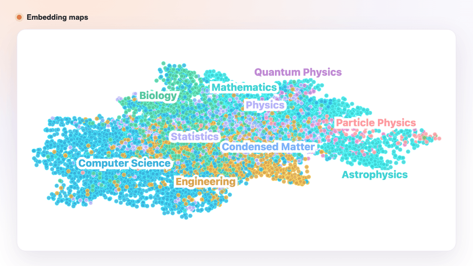
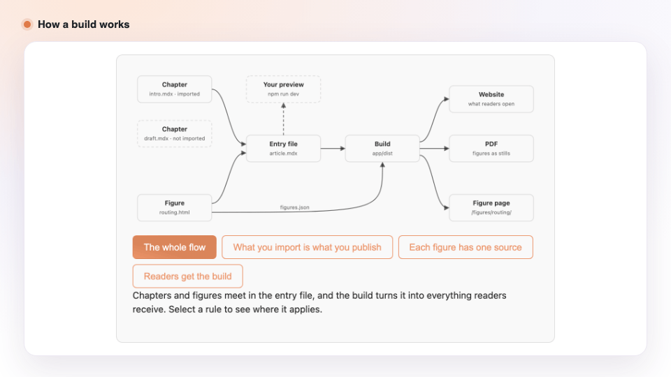

<div align="center">

# Latent Writing Lab

### Research articles your readers can play with.

Write in Markdown. Add figures readers can operate.<br/>
Ship a website, a PDF and figures that embed anywhere.

[](https://github.com/cris96spa/latent-writing-lab/actions/workflows/check.yml)
[](https://cris96spa.github.io/latent-writing-lab/)
[](https://nodejs.org/)
[](https://astro.build/)
[](https://github.com/tfrere/research-article-template)

[**Read the guide →**](https://cris96spa.github.io/latent-writing-lab/) &nbsp;·&nbsp; [Quick start](#quick-start) &nbsp;·&nbsp; [How it works](#how-it-works) &nbsp;·&nbsp; [Your own article](#write-your-own-article)

<br/>

<picture>
  <source media="(prefers-color-scheme: dark)" srcset="docs/images/hero-dark.gif">
  
</picture>

<sub>Every figure above is live in the demo article and the guide. Readers hover, draw, drag and switch, right in the page.</sub>

</div>

<br/>

## Why

A paper states its result and asks you to believe it. An interactive article hands you the knob.

Hugging Face's long-form research posts, like the
[Smol Training Playbook](https://huggingface.co/spaces/HuggingFaceTB/smol-training-playbook),
the [LLM Evaluation Guidebook](https://huggingface.co/spaces/OpenEvals/evaluation-guidebook)
and the [MoE Training Handbook](https://huggingface.co/spaces/huggingface/moe-blogpost), read
like books and behave like notebooks: prose, equations and citations next to figures you can
operate. All three run on Thibaud Frere's
[research-article-template](https://github.com/tfrere/research-article-template).

**Latent Writing Lab is the starter kit for writing your own.** Create a repository from it,
write, and publish. Everything an article needs is ready: a hands-on guide, figures to start
from, embeddable figure pages, PDF export, and browser tests that catch a broken figure before
your readers do.

## Features

<table>
<tr>
<td width="33%" valign="top">

**✍️ Write in Markdown**<br/>
Chapters in MDX with LaTeX math, BibTeX citations, footnotes, notes and sidenotes.

</td>
<td width="33%" valign="top">

**🎛️ Figures readers operate**<br/>
Each figure is one HTML file with D3, SVG, sliders and buttons. Start from working examples.

</td>
<td width="33%" valign="top">

**🔗 Embed anywhere**<br/>
Any figure can get its own page, ready to drop into another site with an iframe.

</td>
</tr>
<tr>
<td width="33%" valign="top">

**📄 Website and PDF**<br/>
One build gives a static site in light and dark, a PDF and LaTeX, with figures captured for print.

</td>
<td width="33%" valign="top">

**✅ Tested like code**<br/>
Browser tests operate your figures in both themes and at phone width, on every push.

</td>
<td width="33%" valign="top">

**🤖 Agent-ready**<br/>
`AGENTS.md` and skills teach coding agents the conventions, from figure code to prose style.

</td>
</tr>
</table>

## Quick start

You need [Node.js](https://nodejs.org/) 22.12 or later.

```sh
git clone https://github.com/cris96spa/latent-writing-lab.git && cd latent-writing-lab
npm ci
npm run dev
```

Open <http://127.0.0.1:4321> for the demo article, which shows every component the engine
offers. To read the guide next to it, run `make doc` in a second terminal and open
<http://127.0.0.1:8031>.

## How it works

You write chapters and figures. One entry file, `article.mdx`, decides what goes into the
article, and the build turns it into everything your readers get.

<div align="center">
<picture>
  <source media="(prefers-color-scheme: dark)" srcset="docs/images/rules-dark.gif">
  
</picture>
</div>

Three rules keep it predictable:

- **What you import is what you publish.** A chapter ships only when `article.mdx` imports it.
- **Each figure has one source.** The same HTML file feeds the article and the figure's own
  page, so one fix reaches both.
- **Readers get the build.** Checks and exports run on the static site, not your local preview.

## Write your own article

1. Click **Use this template** to create a repository for your article.
2. Clone it, then run `npm ci` and `npm run dev`.
3. Replace the demo with your first chapter: the guide's
   [Start your own project](https://cris96spa.github.io/latent-writing-lab/#start-your-own-project)
   section does it in two files.
4. Run `npm run check` and `npm run test:e2e`, then deploy `app/dist` to any static host, a
   Hugging Face Space or the included Docker image.

<details>
<summary><b>Where things live</b></summary>
<br/>

| Path                                          | What it holds                                       |
| --------------------------------------------- | --------------------------------------------------- |
| `app/src/content/article.mdx`                 | Article metadata and the chapters, in reading order |
| `app/src/content/chapters/`                   | Your chapters                                       |
| `app/src/content/embeds/`                     | Your figures, one HTML file each                    |
| `app/src/content/bibliography.bib`            | Your references                                     |
| `app/src/content/assets/`                     | Images, audio and datasets                          |
| `app/src/content/figures.json`                | Figures that get their own embeddable page          |
| `app/src/components/`, `plugins/`, `scripts/` | The template's engine; no need to touch it          |
| `docs/`                                       | The guide and the maintainer documentation          |
| `tools/`, `e2e/`                              | Checks and browser tests                            |

</details>

## Documentation

- **[The guide](https://cris96spa.github.io/latent-writing-lab/)**: from a new repository to a
  published article, with live figures. Start here to write.
- **[How it works](docs/how-it-works.md)**: follow one figure from an HTML file to every page
  that shows it, and see why each piece exists.
- **[Reference](docs/reference.md)**: every command and check, CI, engine updates and work on
  the docs.

## Credits

The article engine, its components and the demo content are Thibaud Frere's
[research-article-template](https://github.com/tfrere/research-article-template), licensed under
[CC BY 4.0](LICENSE). Demo figures keep their attribution in their captions.
