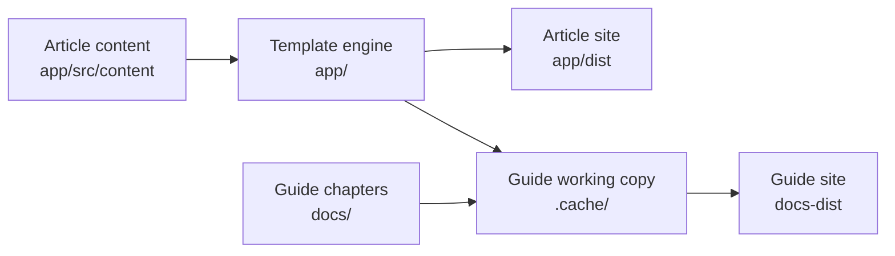

# Architecture

The workspace has to reconcile two needs. Authors want the full research article template,
with its layout, citations, theming and exporters, and they want upstream fixes to keep
arriving. They also need things the template does not provide: figure pages that other
websites can embed, a guide that demonstrates the engine with live examples, and checks that
catch mistakes before publication. The workspace handles both by treating the template as a
pinned dependency that it never edits, and by keeping its own code to a few small extensions
around it.

## The article build

The Astro application in `app/` is the template. Its entry point, `app/src/content/article.mdx`,
holds the article's metadata in frontmatter and imports the chapters, and the order of the
chapter tags in its body is the order of the article. The template's Markdown plugins handle
math, citations, footnotes, tables and the plain-text `llms.txt` export, while its components
render the article shell, theme toggle, table of contents, figures and download controls. The
result is a static site in `app/dist`, with no server code, which is why the container only
needs nginx to serve it.

The root `package.json` is an npm workspace that contains `app/`. Its scripts forward to the
template's own (`dev`, `build`, `preview` and the exporters), so the upstream documentation's
commands work unchanged from the repository root, and it adds the project's checks.

## One figure source, two pages

A figure is one HTML file in `app/src/content/embeds/`. In a chapter, the template's embed
component, `HtmlEmbed`, wraps that file with its title and caption and mounts its script. The
local page `app/src/pages/figures/[name].astro` renders the same component in a standalone
document for each entry in `app/src/content/figures.json`, with the template's stylesheet,
palettes and theme control around it. Because both pages render the same file through the
same component, a fix to the figure reaches both, and there is no second visualization
runtime to maintain. Other websites show the standalone page in an iframe, as described in
[Reuse a figure on another website](integration.md).

## The guide runs on a working copy

The guide is itself an article, written in `docs/article.mdx` and `docs/chapters/`, so that its
examples run on the same engine as the reader's article. The engine reads its content from
fixed paths under `app/src/content`, through both module imports and filesystem reads, and
serving the guide from that directory would mean swapping out the author's article. Instead,
`tools/docs.mjs` copies the application into `.cache/` and puts the guide's entry point and
chapters in place of the article's. Embeds and assets still come from `app/src/content`, so
the guide shows the same figures the article uses. Figures that only the guide needs live in
`docs/embeds/`, which the tool merges into the copy's embeds. Because a guide figure with the
same name as an article figure would silently replace it, the tool refuses to start instead.

In development, the tool mirrors edits to guide chapters, guide figures, embeds and assets
into the working copy. Changes to engine files, the bibliography or the figure registry need a restart, because
the copy is made when the server starts. The build writes `docs-dist/`. The author's files are
never touched, so `npm run dev` and `make doc` can run at the same time.

## Checks

A build can succeed while the engine has been edited by accident or a figure has stopped
responding, so the workspace adds checks for both. `tools/check-content.mjs` compares every
template file against the SHA-256 hash recorded in `template-provenance.json` and validates the
figure registry, which makes an accidental edit to the engine fail before the build does.
`tools/check-docs.mjs` checks the relative links in the documentation. Playwright tests then
cover what a build cannot: that figures mount, respond to their controls and keep their
mathematical invariants, in both themes and at phone width. CI runs all of them on Node 22
and 24. [Verification](verification.md) describes each check.

## What the workspace owns

Local code is limited to the standalone figure page, `tools/`, `e2e/`, the workspace
configuration, CI and the documentation. Everything else under `app/`, outside the author's
`app/src/content`, belongs to the template; `AGENTS.md` states the ownership rules, and
[Upstream and provenance](baseline.md) explains how the template is pinned and updated.
