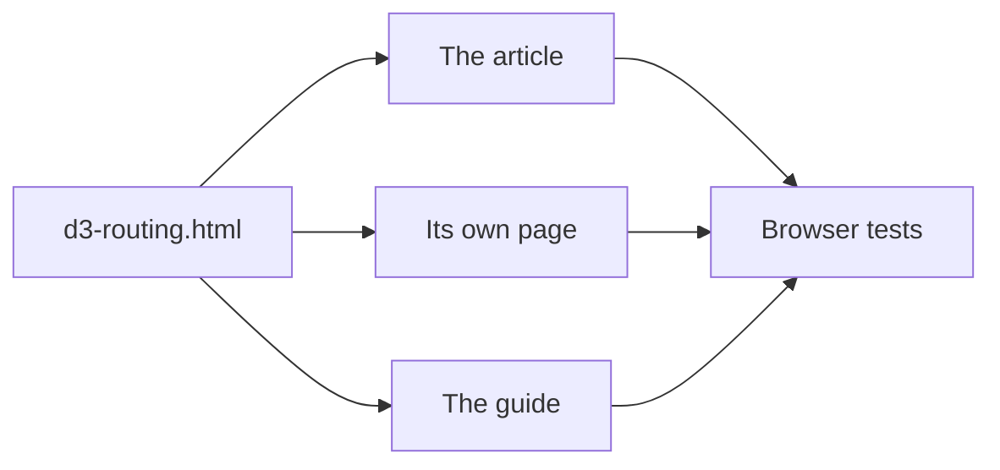
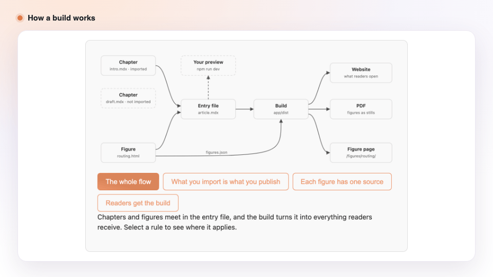
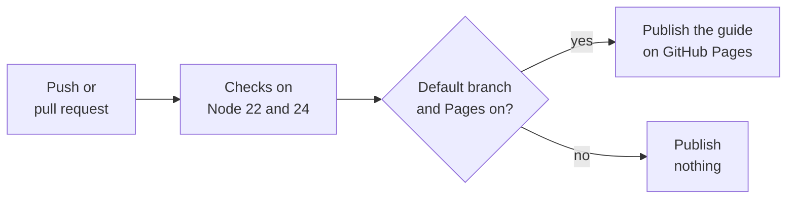

# How it works

**Follow one figure from an HTML file to every page that shows it, and see why each piece exists.**

[Project README](../README.md) · [Guide](https://cris96spa.github.io/latent-writing-lab/) · **How it works** · [Reference](reference.md)

 

Most of Latent Writing Lab is someone else's code, and that is deliberate. The article engine is
Thibaud Frere's [research-article-template](https://github.com/tfrere/research-article-template),
the engine behind Hugging Face's long-form playbooks, and it already does the hard part of a
research article: the layout, math, citations, theming, table of contents and PDF export. What
it leaves out is everything around the article. A figure has no page that another site can
embed, there is no guide whose examples run, and nothing notices when a figure stops responding.
The kit adds those pieces, keeps each one small, and never edits the engine it builds on.

The quickest way to see how the pieces fit is to follow one figure through all of them. The
routing figure, `d3-routing.html`, shows how a mixture-of-experts router splits a token between
its experts. It starts as one file, appears in the article, gets a page of its own, is tested
in a browser, and appears again in the guide.

## A figure is one HTML file

The routing figure lives in `app/src/content/embeds/` as a fragment of HTML with three parts:
one root element, a style block scoped to that element's class, and a script wrapped in a
function that mounts the figure. Inside the script, the figure draws with whatever suits it,
whether SVG, Canvas or D3. Nothing is compiled ahead of time, so a figure is a file you can
open, read and copy.

The file keeps its model apart from its drawing. One pure function turns the router's scores,
the temperature and the number of active experts into weights, and another function draws
those weights. That split is what later lets a test check the science instead of the pixels.

Why plain HTML rather than React components or a charting library? Because it is the form the
engine supports. The template's embed component mounts exactly this kind of fragment and
supplies the palettes and theme variables around it. We also looked at how Hugging Face's
mixture-of-experts handbook builds its figures, since it runs on the same template. Its figures
come from a separate gallery application whose source is not published, and the gallery modules
build their SVG by hand rather than through one library. With nothing there to adopt, native
embeds are the closest supported equivalent.

<b>What the inspection found</b>

 

We inspected the public Space
[`huggingface/moe-blogpost`](https://huggingface.co/spaces/huggingface/moe-blogpost) on
7 November 2026, at commit `ef70726e6f8b99d74298a16a4894340f288a58c2`, reading its compiled
figure bundles as well as its dependency manifest.

| Layer                | What the snapshot shows                                                                       | Where                                                      |
| -------------------- | --------------------------------------------------------------------------------------------- | ---------------------------------------------------------- |
| Article              | Astro 4 and MDX with KaTeX and citation plugins, from Thibaud Frere's template                | `app/package.json`, `app/astro.config.mjs`                 |
| Figure embedding     | Lazy iframes addressing `?c=figure-name`, with reserved sizes and a poster fallback           | `app/src/components/Viz.astro`                             |
| Figure gallery       | A Vite-built application that imports each figure module on demand                            | `app/public/viz/`                                          |
| Drawing              | 55 modules export a `render` function that builds an SVG string; the bundle diffs its own DOM | `hero-dense-to-moe-*.js`, `router-temperature-*.js`        |
| Large headline scene | Custom Canvas 2D code                                                                         | `app/public/headline-iso/`, `app/public/headline-overlap/` |

The manifest lists Svelte and D3, but the snapshot contains no `.svelte` file, and the modules
do not draw through D3, so neither explains the style. `Viz.astro` refers to a
`scripts/sync_gallery.sh` that is absent, along with the gallery's source, so the framework the
gallery was written in cannot be established. The manifest declares CC BY 4.0, which does not by
itself establish the license of the gallery bundles, and the kit copies none of them.

Sources: the
[manifest](https://huggingface.co/spaces/huggingface/moe-blogpost/blob/ef70726e6f8b99d74298a16a4894340f288a58c2/app/package.json),
the
[embed wrapper](https://huggingface.co/spaces/huggingface/moe-blogpost/blob/ef70726e6f8b99d74298a16a4894340f288a58c2/app/src/components/Viz.astro),
the
[gallery assets](https://huggingface.co/spaces/huggingface/moe-blogpost/tree/ef70726e6f8b99d74298a16a4894340f288a58c2/app/public/viz/assets)
and the
[Canvas headline](https://huggingface.co/spaces/huggingface/moe-blogpost/blob/ef70726e6f8b99d74298a16a4894340f288a58c2/app/public/headline-iso/index.html).

A file in a folder is not yet something a reader sees. How does it reach the article?

## The article imports it

A chapter places the figure with the embed component, which adds the title and caption and
starts the figure's script once the figure scrolls into view. The chapter is MDX, and one entry
file, `app/src/content/article.mdx`, imports the chapters in reading order. That list of imports
is the article: a chapter it does not import is never built.

The template's build, run by Astro, turns the entry file into a static site in `app/dist`, made
of HTML, scripts, data and images with no server code. That is why the supplied container needs
only nginx. It is also why the PDF exporter works the way it does: it opens the built site in
Chromium and replaces each figure with a screenshot of the state the figure opens in, so that
state is what reaches paper.

<picture>
  <source media="(prefers-color-scheme: dark)" srcset="images/rules-dark.gif">
  
</picture>

The guide condenses this flow into three rules, animated above: what you import is what you
publish, each figure has one source, and readers get the build, not your preview. The root
`package.json` is an npm workspace around `app/` whose scripts forward to the template's own,
so the upstream documentation's commands work unchanged from the repository root.

That covers readers of the article. What about a reader on another website?

## It gets a page of its own

The same figure might belong on your personal site or in a course page. Copying it there would
create a second implementation that drifts from the first, so the figure stays in one project
and gets a page that other sites can frame. Each entry in `app/src/content/figures.json` becomes
a standalone page at `/figures/<name>/`, and the routing figure's page is `/figures/routing/`.

That page, `app/src/pages/figures/[name].astro`, is the only rendering code the kit adds, and it
is about fifty lines long. It renders the figure through the same embed component, inside a
document with the template's stylesheet, palettes and theme control, so a fix to the figure
reaches the article and the standalone page together. Another site shows the page in an iframe,
which is a separate document: the host needs none of the figure's dependencies, and the two
sites' styles cannot collide.

The iframe has a cost. It does not follow the host page's theme and does not resize itself,
because both would need a messaging protocol between the two documents that the page does not
implement. The host chooses a height that fits the figure on desktop and phone.

With two places showing the figure, how do you know it still works in both?

## Checks prove it still works

A passing build proves that the article compiles. It does not prove that the figure responds,
or that the engine underneath is still the one you started from, so the kit checks both.

The engine check comes first. `template-provenance.json` records the upstream commit the engine
comes from and a SHA-256 hash of every template file, and `npm run check` recomputes those hashes
before anything is built. An accidental edit to the engine fails at once, naming the file. This
is what keeps engine updates reviewable: because the engine is known to match upstream, an
update is a comparison between two upstream revisions, not a hunt for local changes.

The browser tests come next. They open the production builds of the article and the guide in
Chromium and operate the figures the way a reader would. For the routing figure, they step both
controls through a grid of values, read the exact weights the figure records next to each
rounded percentage, and confirm that the weights sum to one and that temperature never
reorders the experts. Other tests switch to the dark theme, shrink the page to phone width, frame a figure in
a host page and load the routing page without JavaScript. The tests serve the installed copy of
D3 in place of the CDN, so the network never decides a result. The deployed site still loads
D3 from the CDN, which only a look at the live page can confirm.

No check can tell whether a sentence is true, whether a figure makes its point or whether the
PDF reads well. That review happens in a pull request, by people.

CI runs every check on Node 22 and 24 for each push, pull request and manual run, and keeps the
builds and the test report for 14 days. On the default branch, it also publishes one thing:

CI never deploys the article. Publishing it is always a step the author takes. The one site CI
does publish is the guide, which is where the routing figure appears for the last time.

## The guide runs it again

The guide is an article too, written in `docs/article.mdx` and `docs/chapters/`, and the routing
figure in it is the same file rendered by the same engine. Its examples therefore cannot drift
from what an author gets. The engine, however, reads content from fixed paths under
`app/src/content`, through both module imports and filesystem reads, so serving the guide from
there would mean replacing your article with it.

Instead, `tools/docs.mjs` copies the application into `.cache/` and puts the guide's entry file
and chapters in place of the article's. Figures and assets still come from `app/src/content`.
A figure only the guide needs, such as its three-rules diagram, lives in `docs/embeds/` and is
merged into the copy, and the tool refuses to start if that figure's name matches an article
figure, which it would otherwise silently replace. Your own files are never touched, so the
article preview and the guide preview run side by side.

GitHub Pages serves a repository's site under a subpath, such as `/latent-writing-lab/`, while
the engine assumes it sits at the site root. The guide build therefore takes Astro's `--base`
option, and the tool prefixes the root-relative links the template writes, again without
editing the engine. The [reference](reference.md#publish-the-guide-on-github-pages) has the
setup and its limits.

## Who owns what

Following the figure has touched every part of the repository, and each part has one owner:

| Owner        | Paths                                                                        | Changes through                                    |
| ------------ | ---------------------------------------------------------------------------- | -------------------------------------------------- |
| You          | `app/src/content/`                                                           | Your chapters, figures, data and references        |
| The kit      | `app/src/pages/figures/`, `docs/`, `tools/`, `e2e/`, CI and workspace config | Reviewed changes to this starter                   |
| The template | Everything else under `app/`                                                 | An [engine update](reference.md#update-the-engine) |

`AGENTS.md` gives coding agents the same rules, and the skills in `.ai/skills/` teach them the
conventions, from figure code to prose. To write an article, start with the
[guide](https://cris96spa.github.io/latent-writing-lab/). To run, test or maintain the kit, the
[reference](reference.md) has every command and procedure.

 

<a href="../README.md">← Project README</a> · <a href="reference.md">Reference →</a>

