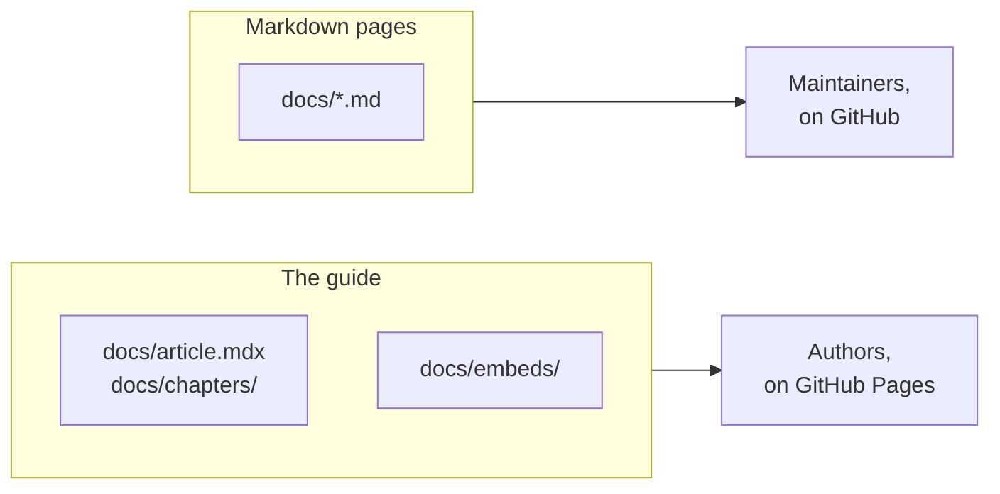

<div align="center">

# Reference

**Every command, check and maintenance procedure, in one place to look them up.**

<sub>[Project README](../README.md) · [Guide](https://cris96spa.github.io/latent-writing-lab/) · [How it works](how-it-works.md) · **Reference**</sub>

</div>

<br/>

This page is for running and maintaining the kit. To write an article, follow the
[guide](https://cris96spa.github.io/latent-writing-lab/); for why the pieces are arranged as they
are, read [How it works](how-it-works.md).

[Commands](#commands) · [Tests](#tests) · [CI](#ci) ·
[Publish the guide on GitHub Pages](#publish-the-guide-on-github-pages) ·
[Update the engine](#update-the-engine) ·
[Bring starter fixes into an article project](#bring-starter-fixes-into-an-article-project) ·
[Work on the docs](#work-on-the-docs)

## Commands

Run every command from the repository root, with Node.js 22.12 or later.

| Command                     | What it does                                                                              | Address                  |
| --------------------------- | ----------------------------------------------------------------------------------------- | ------------------------ |
| `npm run dev`               | Live preview of the article                                                               | <http://127.0.0.1:4321/> |
| `npm run build`             | Builds the article into `app/dist`                                                        |                          |
| `npm run preview`           | Serves `app/dist`, the build readers get                                                  | <http://127.0.0.1:8080/> |
| `make doc`                  | Live preview of the guide; choose a port with `make doc DOC_PORT=8032`                    | <http://127.0.0.1:8031/> |
| `make doc-build`            | Builds the guide into `docs-dist`                                                         |                          |
| `npm run docs:preview`      | Serves `docs-dist`                                                                        | <http://127.0.0.1:8033/> |
| `npm run check`             | Checks the template hashes and `figures.json`, checks formatting, then builds the article |                          |
| `npm run docs:check`        | Checks relative links in the README, `AGENTS.md`, the writing skill and `docs/`           |                          |
| `make doc-check`            | Runs `docs:check`, then builds the guide                                                  |                          |
| `npm run test:e2e`          | Runs the browser tests against both builds                                                |                          |
| `npm run format`            | Formats the files `check` verifies                                                        |                          |
| `npm run export:pdf`        | Exports the built article as a PDF; the guide's publishing chapter covers every exporter  |                          |
| `npm run readme:media`      | Records the README animations                                                             |                          |
| `npm run sync:template:dry` | Previews an upstream sync without writing anything                                        |                          |

Without Make, run `npm run docs:dev` in place of `make doc` and `npm run docs:build` in place of
`make doc-build`; `make doc-check` is `npm run docs:check` followed by `npm run docs:build`. The
article and guide previews run side by side.

## Tests

`npm run test:e2e` serves the production builds of the article and the guide and operates them
in Chromium.

> [!TIP]
> The tests build nothing. Run `npm run build` and `make doc-check` first, and install Chromium
> once with `npx playwright install chromium`. Outside CI, the tests reuse a preview server that
> is already running, so rebuild after every edit or you test an old build.

| Suite                 | Covers                                                                                                                                                                                                   |
| --------------------- | -------------------------------------------------------------------------------------------------------------------------------------------------------------------------------------------------------- |
| `e2e/article.spec.ts` | The full demo with its images and data; the routing figure's invariants; the function plotter; standalone pages in dark mode and at phone width; a host page framing a figure; the no-JavaScript summary |
| `e2e/docs.spec.ts`    | The guide's live figures, the rules figure, the first-article walkthrough, the theme toggle at phone width, and the link to a standalone figure                                                          |

The tests serve the installed D3 package in place of the CDN copy, so their results never depend
on the network.

The guide tests look for specific text. Change `e2e/docs.spec.ts` in the same commit as any of
it:

| Text                                                | Where                                                                 |
| --------------------------------------------------- | --------------------------------------------------------------------- |
| "Write an interactive article"                      | The guide's title in `docs/article.mdx`, also expected in `/llms.txt` |
| "Make a first article you can run"                  | The first-article heading, followed by its `import MyArticle` line    |
| "First time here? Set up the tools and the preview" | The setup accordion, closed by default                                |
| `guide-rules`, `guide-routing`                      | Figure ids in the chapters                                            |
| The rule button labels                              | `docs/embeds/guide-three-rules.html`                                  |
| "Open the same routing figure on its own"           | The link to the standalone routing page                               |

## CI

`.github/workflows/check.yml` runs on every push, pull request and manual run.

| Job                        | Runs                                                                                                 | When                                                                      |
| -------------------------- | ---------------------------------------------------------------------------------------------------- | ------------------------------------------------------------------------- |
| Validate on Node 22 and 24 | `.github/actions/validation`: `npm ci`, `check`, `docs:check`, the guide build and the browser tests | Always                                                                    |
| Build the guide for Pages  | Checks the Pages source, then builds the guide with the Pages base path                              | Pushes and manual runs on the default branch, after both validations pass |
| Publish the guide          | Deploys that build to GitHub Pages; the only job that can write to Pages                             | When the Pages source is GitHub Actions                                   |

Each validation keeps the article build, the guide build and the Playwright report as an
artifact for 14 days. Actions are pinned to commits, and jobs get read-only repository access. On
most branches a newer run cancels the one it supersedes; on the default branch it waits, so a
deployment in progress always finishes. The layout follows
[python-repo-template](https://github.com/cris96spa/python-repo-template/tree/bb9485eaefb7c264e265ace293024547a3404695/.github).

## Publish the guide on GitHub Pages

CI publishes the guide that `make doc` serves locally, once you switch it on: in **Settings →
Pages**, set **Source** to **GitHub Actions**. From then on, every push to the default branch
that passes validation deploys the guide to `https://OWNER.github.io/REPOSITORY/`.

> [!NOTE]
> Until the source is set, CI leaves a notice and publishes nothing. Article projects created from
> the starter behave the same way, so none of them publishes a guide by accident.

To try a Pages build locally:

```sh
npm run docs:build -- --base /latent-writing-lab/
```

```text
Prefixed 10 root-relative links in 5 pages with /latent-writing-lab/.
```

The prefixing has two limits. It covers `src` and `href` attributes in the built pages, not
addresses that a figure's script builds at run time, so a guide figure must not fetch a
root-relative path such as `/data/...`. And the build does not set Astro's `site`, because the
installed sitemap integration fails under Astro 4 when it is set, so the published guide has no
sitemap or canonical addresses.

To host the guide elsewhere, run `make doc-build` and deploy the contents of `docs-dist/` at an
origin root, or build with `--base` for a subpath.

## Update the engine

The engine is used exactly as upstream ships it. `template-provenance.json` records the upstream
commit and a SHA-256 hash of every template file, and `npm run check` stops at the first file
that differs, naming it.

> [!TIP]
> When that check fails, review the named file. Re-recording the hash to silence the check hides
> exactly the change it exists to catch.

| From upstream (CC BY 4.0, in `LICENSE`)                                         | Added by the kit                                           |
| ------------------------------------------------------------------------------- | ---------------------------------------------------------- |
| Components, styles, plugins and scripts under `app/`                            | The routing figure and the standalone figure page          |
| The `article-frontmatter`, `create-html-embed` and `deploy-to-hf-spaces` skills | The `write-documentation` skill                            |
| The demo article, its figures, images, audio and datasets                       | `tools/`, `e2e/`, the guide and docs, CI, workspace config |

`app/package.json` differs from upstream in two ways: `private: true` prevents an accidental
publication to npm, and the development and preview servers bind to localhost. The demo content
is stored as ordinary files, with checksums under `demoContent` in the provenance file, so a fresh
clone runs the demo without a Git LFS download.

The template's sync command touches root files as well as the application, and it preserves
content but not the kit's rules and configuration.

> [!WARNING]
> Never run the sync in your working copy of the repository: it can overwrite the kit's
> configuration and instructions. Review every update in a disposable copy.

1. Copy the repository to a scratch directory and run the sync there.
2. Compare the result with the pinned revision, and decide which upstream changes to accept.
3. Bring the accepted changes into the repository, keeping your content, the standalone figure
   page, the tooling and the local instructions.
4. Record the new commit and hashes in `template-provenance.json`, and update the root
   `package-lock.json`.
5. Run the checks, the browser tests and a PDF export.

Contribute engine fixes upstream rather than patching them here. If a local change to a template
file is unavoidable, keep it small and record it in the provenance file.

> [!CAUTION]
> The template's dependency ranges include Astro 4 and other packages with known security
> advisories, and several fixes need coordinated major upgrades. Run `npm audit` when reviewing an
> update. The servers bind to localhost and the container serves static files with nginx, but
> the build still processes content, expressions and images, which must come from trusted sources.

## Bring starter fixes into an article project

An article project created with **Use this template** is a snapshot of the starter, so later
starter fixes, such as CI changes, do not reach it on their own. Note the starter commit a project
began from in its README, then bring each later fix across as a reviewed patch and run the
project's checks. The template's sync command updates the engine only, not the starter's CI or
guide.

> [!CAUTION]
> Never copy the starter's `app/src/content` over an article project's: it replaces the article
> with the demo.

## Work on the docs

The documentation has two surfaces, and the [writing skill](../.ai/skills/write-documentation/SKILL.md)
sets the style of both. The guide is for authors and runs on the engine, so its figures are live
next to the instructions that use them. These Markdown pages are for people running or changing
the kit, and GitHub renders them without any install. Put a fact where its reader looks, and in
one place only: writing, figures and publishing belong in the guide; how the kit works and how to
maintain it belong here.



**Preview.** `make doc` reloads guide chapters, figures and assets as you edit them. Engine
files, the bibliography and `figures.json` need a restart, because the guide's
[working copy](how-it-works.md#the-guide-runs-it-again) is made at startup. A guide chapter
imports components from `../../components/`, which resolves inside the working copy even though
no such folder sits next to `docs/chapters/`.

**Diagrams.** In the guide, a diagram is an HTML embed like any other figure, because Mermaid in
MDX cannot follow the theme, adapt to a phone or highlight what the prose discusses. Mermaid
belongs only in these Markdown pages. A figure only the guide uses goes in `docs/embeds/`, under
a name no article figure uses.

**Code width.** The guide's code column fits about 68 characters, so `.prettierrc` formats code
in `docs/chapters/` at that width; wrap the prose inside an MDX example by hand to match. A
real command or output line that is longer stays as it is.

**Check a change.** Run every command and snippet you changed in a disposable copy of the
repository, including the guide's first-article walkthrough and its replacement test. Then:

```sh
make doc-check
npm run build
npm run test:e2e
```

**Refresh the README animations.** The animations are recordings of real figures from the demo
article and the guide, in both themes, so they go stale when a figure changes.
`tools/readme-media.mjs` plays a scripted scene on each figure, places every frame on a common
stage with a label, and writes the GIFs to `docs/images/`. Each scene lists its actions and how
long each state stays on screen, so changing a recording means editing that list.

```sh
npm run build
make doc-build
npm run readme:media
```

<br/>

<div align="center"><sub><a href="how-it-works.md">← How it works</a> · <a href="../README.md">Project README</a></sub></div>
